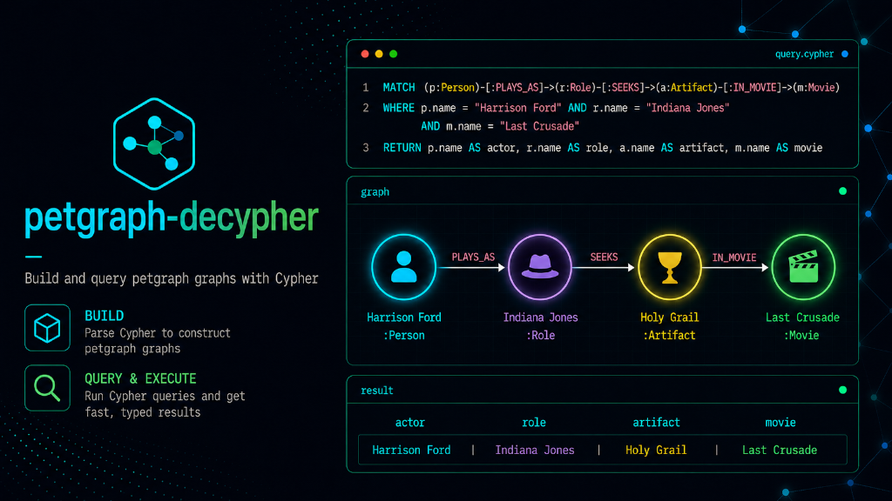

# petgraph-decypher

Cypher-compatible front-end for [`petgraph`](https://crates.io/crates/petgraph):
build, query, and mutate graphs with
[openCypher](https://opencypher.org/)-compatible queries.

<div align="center">
  
</div>

This project is independent and is not affiliated with, endorsed by, or sponsored by Neo4j, Inc.
Cypher® and Neo4j® are registered trademarks of Neo4j, Inc.

## Overview

`petgraph-decypher` runs openCypher queries against `petgraph` graphs:

1. Build graphs with `CREATE` / `MERGE`.
2. Query and mutate any `Graph<N, E>` or `StableGraph<N, E>`, using the bundled
   `NodeData` / `EdgeData` weights or your own.

Queries are parsed and analyzed by [`decypher`](https://crates.io/crates/decypher)
and executed directly on its high-level IR; results reference nodes and
relationships by their petgraph index.

```rust
use petgraph_decypher::{PetgraphCypher, PetgraphCypherMut, Value, build_graph_from_cypher};

let mut graph = build_graph_from_cypher(
    "CREATE (:Person {name: 'Alice'})-[:KNOWS]->(:Person {name: 'Bob'})",
).unwrap();
graph.cypher_mut("MATCH (p:Person {name: 'Bob'}) SET p.age = 42").unwrap();

let result = graph.cypher("MATCH (a)-[:KNOWS]->(b) RETURN a.name, b.age").unwrap();
assert_eq!(result.columns(), ["a.name", "b.age"]);
let row = result.rows().next().unwrap();
assert_eq!(row.get("b.age"), Some(&Value::from(42)));
```

## What works

| Feature | Status |
|---------|--------|
| `MATCH`, `OPTIONAL MATCH`, `WHERE`, `WITH`, `UNWIND`, `RETURN`, `UNION [ALL]` | ✅ |
| `DISTINCT`, `ORDER BY`, `SKIP`, `LIMIT`, aggregation (`count`, `sum`, `avg`, `min`, `max`, `collect`, `stDev`, percentiles) | ✅ |
| `CREATE`, `MERGE` (`ON CREATE` / `ON MATCH`), `SET`, `REMOVE`, `[DETACH] DELETE`, `FOREACH` | ✅ |
| Variable-length relationships (`*1..3`), path variables, label expressions (`:A\|B`, `:!A`) | ✅ |
| Parameters (`$name`), list/pattern comprehensions, quantifiers, `reduce`, `CASE`, map projection | ✅ |
| Scalar, string, math, list and graph functions (`labels`, `type`, `nodes`, `keys`, …) | ✅ |
| Temporal types and functions (`date()`, `duration()`, …) | ❌ |
| `EXISTS { … }` / `COUNT { … }` subqueries, `CALL`, procedures, `LOAD CSV`, `=~` | ❌ |

## openCypher conformance

`cargo test --test tck` executes the official openCypher TCK (release 2024.3,
vendored in [`tests/tck`](tests/tck/README.md)) against petgraph graphs and
compares result tables, errors and side effects: **2746 of 3897 scenarios
pass**. Of the 1100 failing, most need temporal types; the others are
`EXISTS` / `COUNT` subqueries and argument errors that decypher reports
while preparing a query where the TCK expects them at runtime. They are
listed in `tests/tck/known_failures.txt`; the test fails if a new scenario
breaks or a listed one starts passing.

## API

```rust
use petgraph::stable_graph::StableGraph;
use petgraph_decypher::{EdgeData, NodeData, Parameters, PetgraphCypher, Query, Value};

// Run a query once …
let mut graph = StableGraph::<NodeData, EdgeData>::new();
use petgraph_decypher::PetgraphCypherMut;
graph.cypher_mut("UNWIND range(1, 3) AS i CREATE (:Item {id: i})").unwrap();

// … or prepare it once and execute it many times.
let by_id = Query::new("MATCH (n:Item {id: $id}) RETURN n").unwrap();
let params = Parameters::from([("id".to_string(), Value::from(2))]);
let result = by_id.execute(&graph, &params).unwrap();
let Some(Value::Node(n)) = result.column("n").next() else { unreachable!() };
assert_eq!(graph[*n].properties["id"], Value::from(2));
```

- `PetgraphCypher::cypher` / `cypher_params` run read-only queries on any
  `CypherGraph` (`Graph` and `StableGraph`).
- `PetgraphCypherMut::cypher_mut` / `cypher_mut_params` run any query and
  return its rows.
- `Query::new` parses and analyzes once; `execute` / `execute_mut` run it.
- `QueryResult` has `columns()`, `rows()` (with `Row::get(column)`),
  `column(name)` and `into_rows()`. Column names follow Cypher:
  `RETURN n.name` produces column `n.name`.
- `Value` covers `null`, booleans, integers, floats, strings, lists, maps,
  `Node(NodeIndex)`, `Relationship(EdgeIndex)` and `Path`.
- `PetgraphCypher::cypher_select` (or `Selection::from_result`) collects the
  nodes, relationships and paths a query returns into a `Selection`.
- `to_cypher_create(&graph)` writes any graph as a script of `CREATE`
  clauses that `build_graph_from_cypher` reads back, e.g. to save a graph
  or to load it into another Cypher database.

### Selections and petgraph algorithms

Select a slice of the graph with Cypher, then analyze it with petgraph.
`Selection::induced` and `Selection::edge_filtered` are views that keep the
original indices, so algorithm results refer to the original graph;
`Selection::subgraph` copies the slice into a new graph with a mapping back.

```rust
use petgraph::algo::tarjan_scc;
use petgraph_decypher::{PetgraphCypher, build_graph_from_cypher};

let graph = build_graph_from_cypher(
    "CREATE (a:Page)-[:LINKS]->(b:Page)-[:LINKS]->(a), (b)-[:LINKS]->(:Ad)",
).unwrap();
let pages = graph.cypher_select("MATCH (p:Page) RETURN p").unwrap();
let components = tarjan_scc(&pages.induced(&graph)); // NodeIndex of `graph`
assert_eq!(components[0].len(), 2);
```

`DELETE` is applied when the query finishes. On a `Graph`, removing an
element moves the last element into its slot, so indices of *other* elements
may change, including node and relationship values in the result of the
deleting query itself; use a `StableGraph` when indices must stay valid. A
query that fails leaves the graph unchanged.

### Custom node and edge types

Implement `CypherNode` / `CypherEdge` (labels, type and property access) to
query your own weights, and `CypherNodeMut` / `CypherEdgeMut` (construction
and updates) to mutate them. See `CustomNode` / `CustomEdge` in
`tests/query_tests.rs`.

### Node and edge data

```rust
pub struct NodeData {
    pub variable:   Option<String>, // the CREATE pattern variable, if any
    pub labels:     Vec<String>,
    pub properties: Properties,     // BTreeMap<String, Value>
}

pub struct EdgeData {
    pub variable:   Option<String>,
    pub rel_type:   String,
    pub properties: Properties,
}
```

`examples/indiana_jones.rs` builds a small movie graph and runs read,
aggregation and mutation queries against it.

## License

Licensed under either of [EUPL-1.2](LICENSE-EUPL), [MIT](LICENSE-MIT) or
[Apache-2.0](LICENSE-APACHE) at your option.
